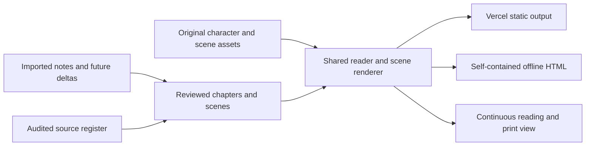

# Architecture contract

Status: implementation-neutral architecture for the confirmed experience. This document defines behavior, boundaries, and future work; it does not select or scaffold a framework.

## Overall shape

The essay is a static, browser-readable experience. Author the story, cast, references, and original scene assets in the repository, then package them for Vercel and for a self-contained offline HTML submission. Both outputs consume the same content and renderer. Runtime access to Google Docs is unnecessary; source imports and later deltas are editorial inputs.

## Boundaries

| Part | Responsibility |
| --- | --- |
| Editorial inputs | Preserve source snapshots, record deltas, distinguish member reflection from hypothetical examples |
| Story content | Ordered chapters and scenes, essential prose, dialogue, concept application, evidence, limits, optional detail |
| Reference registry | Stable source identifiers, bibliographic detail when verified, links, claim roles and limitations |
| Cast registry | Stable member/friend identifiers, display names, original appearances, emotional states |
| Reader | Landing, Begin, Next/Back, chapter navigation, reading mode, focus and presentation state |
| Scene renderer | Draw/reuse/replace scenes, synchronize explanatory changes with the visible argument |
| Detail surfaces | Optional sources, extra examples, and supplementary thoughts without hiding essential content |
| Packaging | Generate hosted files and an offline HTML file from the same authored material |

There is no current requirement for accounts, a database, a live feed, voting, a happiness score, or a complex simulation. Do not introduce them to satisfy static presentation needs.

## Content contract

Choose the concrete storage format during implementation. It must express these relationships:

| Entity | Required information |
| --- | --- |
| Chapter | Stable identifier, title/question, ordered scene identifiers, opening and closing connections |
| Scene | Stable identifier, chapter, essential narrative text, optional dialogue, character/visual state, relevant concept/source identifiers, visible limitations, optional supplementary content |
| Dialogue | Speaker identifier, text, whether it is a member-endorsed position or a fictional friend's illustrative line, relevant source identifiers |
| Source | Stable identifier, label, original URL, verified bibliographic detail, supported claim, limitations, review status |
| Character | Stable identifier, member/friend role, displayed name, original appearance, available expressions |
| Interaction | Explanatory purpose, optional trigger/state, supplemental output, keyboard/touch behavior, static readable equivalent |
| Provenance | Source note or delta location supporting a member position or content change |

Keep editorial audit/provenance information in the authoring material. The product shows citations and meaningful context, not internal workflow metadata. Stable identifiers allow later notes to modify a scene without relying on its numeric position.

Content validation should catch broken references, duplicate or missing identifiers, nonexistent speakers, empty essential scenes, and ordering errors. Tests should exercise meaningful contracts and transitions rather than duplicate implementation details.

## Reading behavior

- Landing opens with the working question, emotional original stickmen, Begin, member names, and an honest reading-time estimate once measured.
- Begin enters the first authored scene. Next and Back traverse the complete sequence; boundary behavior is explicit and keyboard accessible.
- Chapter shortcuts revisit the beginning of a chosen chapter. Readers do not need to repeat earlier optional interactions.
- Presentation and full reading views contain the same essential prose, dialogue, findings, caveats, and conclusion.
- Source links/details can be inspected and dismissed without losing the current scene or keyboard focus.
- Optional comparisons/reveals never gate progression or contain the sole explanation of a major perspective.
- No timer advances prose automatically. Scene motion follows explanation and allows reading at the visitor's pace.

## Illustration and motion

Scenes may reuse the same setting to reveal another condition or replace the composition for a new example. A shared cast/expression vocabulary keeps emotional changes consistent. Generic fictional characters remain distinct from the three real contributors.

Scalable line art is a suitable implementation option; no asset format is mandated. Text and names should remain readable as text. Supply an equivalent description for meaning conveyed visually. Reduced-motion/static presentation must preserve the explanation even when animation is disabled.

## Responsive and accessible presentation

Desktop may place narrative and illustration side by side or within a wide stage. Phones rearrange them into a readable layout. Do not lock readability to the reference site's fixed dimensions.

Use semantic controls, visible keyboard focus, a sensible reading order, legible contrast, text alternatives, and labels above member avatars. Source/detail surfaces should be keyboard reachable and dismissible. Full reading mode provides a direct text route through the complete argument.

## Hosted and offline packaging

Vercel serves the static hosted output. The offline deliverable is a single HTML file containing the required prose, references, styles, scripts, font, and illustrations. It must open through a normal local-file browser URL with network disabled.

Runtime module loading, runtime fetching of content, remote fonts, or remote illustration dependencies must not break offline reading. A service worker is not a substitute for a file that opens directly. External reference destinations can need internet; their labels, claim context, and necessary source details remain readable offline.

Do not invent build commands now. The foundation implementation must document the actual local preview, validation, hosted packaging, and offline export commands it introduces.

## Handoffs that create real prerequisites

The reader depends on the foundation's content/runtime interfaces. Final narrative integration depends on an audited storyboard, a working reader, and original scene assets. Hosted/offline release verification depends on the integrated complete essay. Editorial work and original asset development can begin alongside the foundation using these documented contracts.
