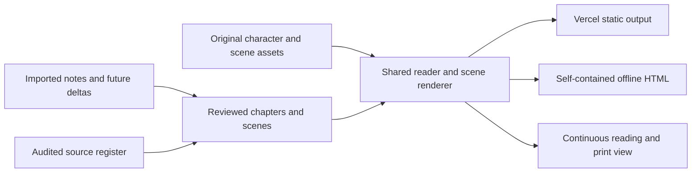

# Architecture contract

Status: implementation-neutral architecture for the confirmed experience. This document defines behavior, boundaries, and future work; it does not select or scaffold a framework.

## Overall shape

The essay is a static, browser-readable experience. Author the story, cast, references, and original scene assets in the repository, then package them for Vercel and for a self-contained offline HTML submission. Both outputs consume the same content and renderer. Runtime access to Google Docs is unnecessary; source imports and later deltas are editorial inputs.

## Boundaries

| Part | Responsibility |
| --- | --- |
| Editorial inputs | Preserve source snapshots, record deltas, distinguish member reflection from hypothetical examples |
| Story content | Ordered chapters and scenes, essential prose, dialogue, concept application, evidence, limits, optional detail |
| Reference registry | Stable source identifiers, bibliographic detail when verified, links, claim roles and limitations |
| Cast registry | Stable member/friend identifiers, display names, original appearances, emotional states |
| Reader | Landing, Begin, Next/Back, chapter navigation, reading mode, focus and presentation state |
| Scene renderer | Draw/reuse/replace scenes, synchronize explanatory changes with the visible argument |
| Detail surfaces | Optional sources, extra examples, and supplementary thoughts without hiding essential content |
| Packaging | Generate hosted files and an offline HTML file from the same authored material |

There is no current requirement for accounts, a database, a live feed, voting, a happiness score, or a complex simulation. Do not introduce them to satisfy static presentation needs.

## Content contract

Choose the concrete storage format during implementation. It must express these relationships:

| Entity | Required information |
| --- | --- |
| Chapter | Stable identifier, title/question, ordered scene identifiers, opening and closing connections |
| Scene | Stable identifier, chapter, essential narrative text, optional dialogue, character/visual state, relevant concept/source identifiers, visible limitations, optional supplementary content |
| Dialogue | Speaker identifier, text, whether it is a member-endorsed position or a fictional friend's illustrative line, relevant source identifiers |
| Source | Stable identifier, label, original URL, the evidence level actually reached, what was opened and read, bibliographic detail, supported claim, limitations |
| Character | Stable identifier, member/friend role, displayed name, original appearance, available expressions |
| Interaction | Explanatory purpose, optional trigger/state, supplemental output, keyboard/touch behavior, static readable equivalent |
| Provenance | Source note or delta location supporting a member position or content change |

Keep editorial audit/provenance information in the authoring material. The product shows citations and meaningful context, not internal workflow metadata. Stable identifiers allow later notes to modify a scene without relying on its numeric position.

Content validation should catch broken references, duplicate or missing identifiers, nonexistent speakers, empty essential scenes, and ordering errors. Tests should exercise meaningful contracts and transitions rather than duplicate implementation details.

## Reading behavior

- Landing opens with the working question, emotional original stickmen, Begin, member names, and an honest reading-time estimate once measured.
- Begin enters the first authored scene. Next and Back traverse the complete sequence; boundary behavior is explicit and keyboard accessible.
- Chapter shortcuts revisit the beginning of a chosen chapter. Readers do not need to repeat earlier optional interactions.
- Presentation and full reading views contain the same essential prose, dialogue, findings, caveats, and conclusion.
- Source links/details can be inspected and dismissed without losing the current scene or keyboard focus.
- Optional comparisons/reveals never gate progression or contain the sole explanation of a major perspective.
- No timer advances prose automatically. Scene motion follows explanation and allows reading at the visitor's pace.

## Illustration and motion

Scenes may reuse the same setting to reveal another condition or replace the composition for a new example. A shared cast/expression vocabulary keeps emotional changes consistent. Generic fictional characters remain distinct from the three real contributors.

Scalable line art is a suitable implementation option; no asset format is mandated. Text and names should remain readable as text. Supply an equivalent description for meaning conveyed visually. Reduced-motion/static presentation must preserve the explanation even when animation is disabled.

The [asset workflow](asset-workflow.md) starts with built-in image generation for concepts, then prepares reusable browser drawing parts and expression states. The first PNG character sheet is authoring input, not a separated animation library. SVG components are a suitable production option. Simple CSS/Web Animations can move or reveal them; Anime.js is optional if coordinated timelines need a helper. Rough.js is optional for sketch-like scenery. No library has been installed yet.

Image generation, drawing editors, and any future MCP connector run during authoring. The deployed and offline reader consumes committed assets and local state only. Motion must cancel or settle to the selected scene's correct state when Next/Back changes the beat, and reduced motion must show the same explanatory state without an animated transition. Keep generated lettering out of production labels and dialogue.

## Responsive and accessible presentation

Desktop may place narrative and illustration side by side or within a wide stage. Phones rearrange them into a readable layout. Do not lock readability to the reference site's fixed dimensions.

Use semantic controls, visible keyboard focus, a sensible reading order, legible contrast, text alternatives, and labels above member avatars. Source/detail surfaces should be keyboard reachable and dismissible. Full reading mode provides a direct text route through the complete argument.

## Hosted and offline packaging

Vercel serves the static hosted output. The offline deliverable is a single HTML file containing the required prose, references, styles, scripts, font, and illustrations. It must open through a normal local-file browser URL with network disabled.

Runtime module loading, runtime fetching of content, remote fonts, or remote illustration dependencies must not break offline reading. A service worker is not a substitute for a file that opens directly. External reference destinations can need internet; their labels, claim context, and necessary source details remain readable offline.

Do not invent build commands now. The foundation implementation must document the actual local preview, validation, hosted packaging, and offline export commands it introduces.

## The implemented foundation

The foundation package filled in the implementation choices this document left open. What follows records what exists, not what is planned.

### Tooling, and why it is this small

Node 24 with **no dependencies at all**. The committed `package-lock.json` contains no packages, tests use Node's built-in runner, and the build uses only `node:fs`, `node:path`, `node:crypto`, and `node:http`.

The reasoning is the offline requirement. A framework or bundler would put a toolchain between the authored content and a file that has to open from a local disk with no network, and every dependency added to that path is another way for the submission artifact to break on the night it is due. A static essay with one page, one stylesheet, and one browser script does not need one. Nothing here prevents a later package from adding a dependency if it earns its place; the decision is only that the foundation did not need one.

Consequences worth knowing: there is no linter, formatter, or type checker configured, so `npm test` runs Node's own parser over every source file instead. The browser script is a classic script rather than an ES module, because module loading is blocked for `file://` documents.

| Path | Role |
| --- | --- |
| `content/content.json` | The single content document. See [the content contract](content-contract.md). |
| `src/content/` | Schema constants, the validator, and the loader. |
| `src/runtime/` | The shared renderer, the stylesheet, and the browser script. |
| `src/build/` | Asset declarations, data-URI inlining, the output audits, and the build. |
| `src/tools/` | The validation command and the local preview server. |
| `test/` | Contract, renderer, packaging, and preview checks, plus a deliberately broken fixture. |

### Commands

| Command | What it does |
| --- | --- |
| `npm run validate` | Checks `content/content.json` against the contract. Exits nonzero with located errors. |
| `npm test` | Runs every check: contract rules, stable-identifier reordering, rendering, packaging, determinism, and the preview server. |
| `npm run build` | Validates, renders, audits, and writes `dist/`. |
| `npm run export:offline` | Writes only `dist/offline.html`. |
| `npm run preview` | Serves `dist/` at `http://localhost:4173`. |
| `npm run check` | `validate`, then `test`, then `build`. |

`dist/` is generated and git-ignored. The exact hosting settings are in [delivery](delivery.md).

### One render, three outputs

`src/runtime/render.js` renders the **entire** essay into the markup — every chapter, every beat, every optional panel — and the browser script only decides what is on screen. That single decision is what makes the rest hold together:

- Print carries the complete argument whichever view is open, and optional panels are reopened before printing.
- A browser with scripting unavailable shows the continuous reading view, which is the same thing the print route needs.
- The hosted page and the offline file differ only in whether their resources are linked or embedded; a build check asserts their visible text is identical.

The build refuses to publish an output that drops essential content, and refuses an offline file that references anything it does not carry. External source destinations stay as ordinary links: offline, their labels, roles, and limitations are all still readable, and only following the link needs a connection.

### Evidence levels reach the reader

A source's `reviewStatus` is the level the audit actually reached: read in full, abstract only, publisher or catalogue description only, or not opened. The contract will not let a source state what it supports at a level where nothing inside the work was read, and the renderer phrases every supported claim against its level, so an abstract or a publisher's description is never presented as a passage from the work. [The content contract](content-contract.md) holds the table; [the register](research.md) holds the audit itself.

The bundled font's licence is rendered into the document rather than left beside it, because the offline file is a copy of the font software and the licence requires its notice to travel with every copy. A build check fails if either output loses it.

### What the foundation did not decide

Final prose, finished artwork, scene motion, the project typeface, and the reader's finished visual design are all still open. The committed font and the committed illustration are temporary and exist to prove binary packaging works end to end.

## Handoffs that create real prerequisites

The reader depends on the foundation's content/runtime interfaces. Final narrative integration depends on an audited storyboard, a working reader, and original scene assets. Hosted/offline release verification depends on the integrated complete essay. Editorial work and original asset development can begin alongside the foundation using these documented contracts.
