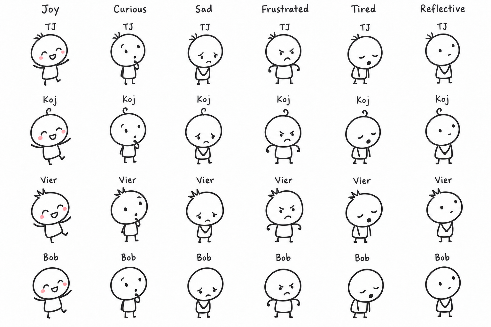

# Asset creation and animation workflow

## Chosen starting point

Use Codex's built-in image generation to create the first character sheets and visual concepts. The user asked for drawings closely matching the visual style of [The Evolution of Trust](https://ncase.me/trust/), with original characters and the happiness essay's own scenes. The user does not need to learn drawing software or install an additional connector to begin.

The target is the reference's opening-page stickmen: large white rounded heads, compact bodies, short legs, simple expressive eyes, slightly imperfect dark outlines, generous white space, and restrained color. See [art direction](art-direction.md). Match the reference's visual language and presentation rhythm; build our own cast, compositions, and argument.

## First generated sheet

| Field | Record |
| --- | --- |
| Asset | [stickman-character-sheet-v1.png](../assets/concepts/stickman-character-sheet-v1.png) |
| Created | 8 October 2026 |
| Method | Built-in image generation, followed by one targeted built-in edit |
| Generation prompt | [Exact initial prompt](../assets/concepts/stickman-character-sheet-v1.prompt.txt) |
| Edit prompt | [Exact edit prompt](../assets/concepts/stickman-character-sheet-v1.edit-prompt.txt) |
| Dimensions | 1536 × 1024 pixels |
| SHA-256 | `ffb60fd660fe36ceb6d83fa74437850ebaa2803b6e2039f83208ad696b6dd8bc` |
| Cast | TJ, Koj, Vier, and fictional friend Bob |
| Expressions | Joy, curiosity, sadness, frustration, fatigue, calm reflection |
| Visual identity | TJ has a small tuft, Koj a curl, Vier an angular tuft, Bob a plain round head |
| Status | Initial visual concept; contributor appearances are provisional |

The edit removed Bob's hair tufts so the generic friend is distinct from TJ. The final image was inspected for consistent identities, the six expressions, readable names above heads, and the intended simple style. This is a concept sheet, not a finished animation or a separated production sprite library. Its lettering illustrates placement; the website will render names, dialogue, and headings as selectable browser text. It does not supply the website's Futura Handwritten font.

## From drawings to moving scenes

1. **Establish the look.** Start with the generated sheet and refine specific appearance details as member feedback arrives. Keep each member recognizable across emotions. Preserve prompts and versioned selected outputs in the repository.
2. **Build one representative scene.** For example, introduce a fictional friend enjoying basketball, then reveal how available time or an obligation changes the situation. Use the audited storyboard to choose the actual claim and scene. The prose carries the argument; the drawing makes its relationships visible.
3. **Prepare reusable parts.** Rebuild the chosen simple line art as scalable components where useful: head, face, body, arms, legs, and scene props. SVG is a suitable browser format for these shapes. Codex can author the SVG directly. Generated PNG concepts do not automatically become editable rigs or consistent animation frames.
4. **Animate the explanation.** Use expression swaps, small limb rotations, pose changes, movement, fades, or prop reveals tied to the current beat. Begin with browser CSS or Web Animations for simple transitions. Anime.js is an optional open-source helper if coordinated timelines warrant it. Next/Back changes the story state; essential reading never waits for an animation to finish.
5. **Reuse and expand.** Extend the cast and scene vocabulary across the six shared questions. Some beats change one scene; others introduce a new composition. Static poses and descriptions retain the same meaning when motion is reduced.
6. **Package both outputs.** Commit production assets locally and include them in both Vercel's static output and the offline HTML. The reader does not call an image generator, connector, or remote design tool at runtime.

The first animated scene, reusable component library, and complete scene set remain work in [the existing art ticket](https://github.com/duckycodess/what-it-takes-to-be-happy/issues/4). Creating this concept sheet does not complete that ticket.

The owner subsequently requested ongoing generated-art support while the website is built autonomously. Workers can submit requests in [art-requests.json](art-requests.json); this chat checks every 15 minutes and supplies isolated asset branches for workers to incorporate. See [the autonomous build handoff](autonomous-build.md).

## Tools and their roles

| Tool | Plain-language role | Project position |
| --- | --- | --- |
| Built-in image generation | Draws character sheets and scene concepts from our descriptions; can revise selected images | Chosen authoring starting point; already available |
| SVG authored by Codex | Describes clean scalable drawing parts that the website can move and reuse | Recommended production option for this simple line art |
| [Inkscape](https://inkscape.org/) | Free, open-source drawing editor for manually adjusting SVG shapes | Optional behind-the-scenes editor; no user learning requirement |
| Browser CSS / Web Animations | Moves, rotates, fades, and reveals drawing parts | Start here for simple motion |
| [Anime.js](https://github.com/juliangarnier/anime) | MIT-licensed library for coordinating browser and SVG animations | Optional when scene timing needs more than simple transitions |
| [Rough.js](https://github.com/rough-stuff/rough) | MIT-licensed library that draws sketch-like shapes in SVG or Canvas | Optional for compatible scenery; does not generate consistent characters |

Image generation is an available authoring service, not an open-source library. Open-source drawing and animation tools can support the website without requiring every authoring step to be open source. No new library or editor has been installed or selected as a mandatory dependency. Record actual versions and license notices when dependencies are added.

## What the reference used

The [reference's README](https://github.com/ncase/trust/blob/gh-pages/README.md) credits PIXI.js for graphics, Howler.js for audio, Tween.js for animation, Balloon.css for tooltips, Q for promises, MinPubSub for events, Pegasus for loading, and Futura Handwritten for typography. Its Tween.js link points to CreateJS TweenJS. This is historical reference information, not a requirement to duplicate the full stack. Our essay can use a smaller static reader because its visual explanation does not need the reference's game simulation.

The README declares Nicky Case's work CC0 and lists third-party resources separately. Keep reference provenance, generated-asset provenance, font provenance, and actual dependency licenses explicit as those assets are added.

## MCP and connector use

MCP is a way for Codex to operate a connected tool. It is not an animation format and does not need to run inside the website. The built-in image generator already covers the initial drawing request.

Discovery surfaced optional Figma, Runway, Higgsfield, and Adobe Express integrations; none was installed for this project. No direct Inkscape or Blender integration surfaced in that search. A connector could help later if a concrete task needs a design document or video workflow, but this stickman website can be authored with built-in generation and repository assets. Pre-rendered video is not required for changing expressions and explanatory scenes.

## Asset checks and handoff

- Member names stay above heads and remain real text in the website. Generated concept-sheet labels are not production UI.
- All members can express different moods; visual identity does not assign a permanent personality or philosophical position.
- Store meaningful scene descriptions and a static final pose alongside motion behavior.
- Check linework, faces, labels, and composition at phone and desktop sizes.
- Preserve transparent backgrounds when generating production cutouts; the first contact sheet intentionally has a white background.
- Keep assets and font available offline. Add a library only when its role and required license notice are recorded.
- Keep concepts separate from integrated production assets; document what has actually been generated, drawn, animated, and tested.
